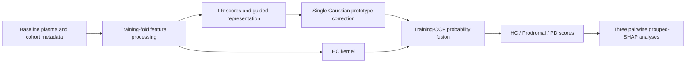

<h1 align="center">DiPP-Label: Single-Prototype and Control-Kernel Fusion for Three-Class Plasma Proteomic Classification</h1>

<p align="center">
  <a href="README_zh.md">中文说明</a> ·
  <a href="docs/method.md">Method</a> ·
  <a href="docs/data.md">Data preparation</a> ·
  <a href="docs/validation.md">Release validation</a> ·
  <a href="LICENSE">MIT License</a>
</p>

## Introduction

Plasma proteomics provides molecular information for distinguishing healthy controls (HC), Parkinson's disease (PD), and prodromal status. DiPP-Label connects this three-class prediction task with protein-level interpretation. A single Gaussian prototype learns a residual correction around logistic-regression scores, while a dedicated HC kernel captures the control-versus-non-control distinction. Training out-of-fold predictions determine their probability mixture. Grouped SHAP then identifies the assay contributions to the PD–prodromal, HC–prodromal, and HC–PD scores. The manuscript reports mean macro-F1 **0.5719** and macro OvO AUC **0.7370** across three participant partitions of a 325-person plasma cohort with diabetes-related evidence. The code below provides the final method, its four component ablations, standard classifier comparisons, and a fully synthetic example. **This release runs on CPU.**



## Synthetic example

[`dataset/example`](dataset/example) contains **216 invented participants and 64 invented protein assays**. It includes missing values, technical QC failures, overlapping project samples, and three additional records that exercise exclusion rules. Every participant, assay name and measurement is synthetic; the generator uses seeded random numbers and explicit toy class shifts, without real PPMI rows or fitted real-data statistics.

| File | Purpose |
| --- | --- |
| [participants.csv](dataset/example/participants.csv) | Enrollment class and eligibility metadata |
| [assays.csv](dataset/example/assays.csv) | Assay identifiers and display names |
| [plasma.csv](dataset/example/plasma.csv) | Long-form NPX, LOD, project, visit and QC fields |
| [SYNTHETIC_DATA.json](dataset/example/SYNTHETIC_DATA.json) | Generation seed, scope and checksums |

These tables illustrate the package's normalized PPMI-style input contract. Synthetic scores demonstrate execution; the manuscript's reported scores come from its real-cohort experiments.

## Model configuration

| Component | Paper recipe | Implementation |
| --- | --- | --- |
| Protein features | NPX, detection and low-detection excess; training-only fitting | [features.py](src/dipp_label/features.py) |
| LR teacher | Balanced multinomial LR, C=0.003 | [numerics.py](src/dipp_label/numerics.py) |
| Gaussian prototype | One 16-dimensional residual encoder; 256 encoder parameters | [model.py](src/dipp_label/model.py) |
| Episodic training | 800 steps; 4 episodes/step; 5 supports + 5 queries/class | [paper.json](configs/paper.json) |
| HC kernel and fusion | RBF kernel, class balancing and training-OOF simplex weights | [model.py](src/dipp_label/model.py) |
| Protein interpretation | Same-assay grouped SHAP for three log-probability ratios | [analysis.py](src/dipp_label/analysis.py) |

[configs/paper.json](configs/paper.json) preserves the final algorithm settings. [configs/example.json](configs/example.json) reduces optimization, search and SHAP budgets for a quick demonstration. Real fitted checkpoints are not bundled: the HC kernel retains training representations. The example trains its own models in memory.

## Usage

### 1. Dataset preparation

Use the included synthetic example to explore the complete workflow. For real data, obtain authorized PPMI exports separately and convert them to the [input contract](docs/data.md):

```text
dataset/
├── example/                 # generated synthetic data included in this repository
│   ├── participants.csv
│   ├── assays.csv
│   ├── plasma.csv
│   └── SYNTHETIC_DATA.json
└── private/my_cohort/        # your authorized data; ignored by Git
    ├── participants.csv
    ├── assays.csv
    └── plasma.csv
```

Data preparation selects baseline plasma, masks QC failures, applies eligibility rules, and prefers a passing Project314 sample over Project293 for the same participant. The `DM_CORE_EVIDENCE` and `QC_Pass` fields are explicit, previously reviewed flags; the adapter does not infer arbitrary clinical or QC codes from text. Assay filtering, imputation, scaling and PCA are fitted within training folds.

### 2. Install the environment

Use **Python 3.10–3.12** and a CPU build of PyTorch:

```bash
git clone https://github.com/tianj5920-del/DiPP.git
cd DiPP
python -m venv .venv
source .venv/bin/activate
python -m pip install torch==2.7.1 --index-url https://download.pytorch.org/whl/cpu
python -m pip install -e '.[analysis,baselines,test]' -c constraints-cpu.txt
python -m pytest -q
```

The tested package versions are pinned in [constraints-cpu.txt](constraints-cpu.txt). SVM and tree classifiers run in isolated CPU processes to keep their binary runtimes separate from PyTorch. CPU thread count is configured in the JSON files.

Check the input tables, or regenerate the example:

```bash
dipp-label check-data --data dataset/example
dipp-label make-example --out dataset/example --overwrite
```

### 3. Training

Run the final model with LightGBM, LR and the analytical random reference:

```bash
dipp-label run --data dataset/example --config configs/example.json \
  --out outputs/example --models dipp_label lightgbm lr random --shap
```

The command performs training-internal validation, full-training fits, held-out evaluation and optional SHAP analysis. Use a new output directory for each run. Switch to `configs/paper.json` for the full training recipe.

The four component ablations are:

| Model name | Configuration |
| --- | --- |
| `without_hc` | LR-guided prototype without the HC kernel |
| `lr_hc` | Same LR + HC kernel, with prototype correction removed |
| `lr_free_hc` | Fully LR-free Gaussian prototype + HC kernel |
| `lr_free` | Fully LR-free Gaussian prototype alone |

<details>
<summary>Commands for all ablations and standard classifiers</summary>

```bash
dipp-label run --data dataset/example --config configs/example.json \
  --out outputs/ablations --models dipp_label without_hc lr_hc lr_free_hc lr_free

dipp-label run --data dataset/example --config configs/example.json \
  --out outputs/classifiers --models lr linear_svm rbf_svm random_forest extra_trees \
  lightgbm xgboost mlp residual_mlp random
```

Classifier settings are selected using training-only OOF OvO AUC. The full parameter grids and neural model definitions are in [baselines.py](src/dipp_label/baselines.py).

</details>

### 4. Inference and evaluation

The public API can fit a model and predict new rows with the same assay catalog:

```python
from dipp_label.config import Config
from dipp_label.data import load_cohort
from dipp_label.model import DiPPLabel
from dipp_label.splits import holdout
from dipp_label.metrics import complete_metrics

data = load_cohort("dataset/example")
train, test = holdout(data, seed=71750)
model = DiPPLabel(Config.load("configs/example.json")).fit(data.take(train))
probabilities = model.predict_proba(data.take(test))
metrics = complete_metrics(data.y[test], probabilities)
# Probability columns: HC, Prodromal, PD.
```

The automatic splitter creates new class-stratified random partitions. To reuse a frozen allocation, pass `--splits allocations.csv` with columns `PATNO,seed,split`. The original private participant assignments are not included; identical seed numbers alone do not reconstruct them.

| Output | Contents |
| --- | --- |
| `run_manifest.json` | Configuration, package versions, class order, cohort counts and split scope |
| `metrics_by_split.csv` | Every model/partition/phase, with all classwise and macro metrics |
| `summary.json` | Repeated-run means and standard deviations |
| `report.md` | Readable overall and classwise comparison tables |

Macro OvO AUC, macro OvR AUC, three pairwise log-ratio AUCs, precision, recall, F1, accuracy, average precision, Brier score and log-loss are reported separately. The CLI writes aggregate results rather than participant predictions.

### 5. Protein analysis

Add `--shap` to a run containing `dipp_label`. All channels from the same assay form one SHAP group. Training participants provide class-balanced backgrounds, and the frozen model explains each continuous class-pair score.

| Output | Contents |
| --- | --- |
| `shap_all_rankings.csv` | Complete rankings for PD–prodromal, HC–prodromal and HC–PD |
| `shap_top50.csv` | Top50 per boundary, contribution magnitude and Top1-normalized importance |
| `shap_checks.json` | Additivity checks, recipient/background counts and cross-split rank consistency |

Importance averages absolute SHAP with equal recipient-class and model weights. Direction summarizes within-class high-versus-low NPX attribution contrasts, using training quartiles. The example explains at most three recipients per class and uses two permutation cycles; the paper configuration explains all test participants and uses sixteen cycles. See [method details](docs/method.md).

## Release validation

The CPU release passed **24 tests** and an end-to-end synthetic run covering **15 model/reference configurations**, yielding **30 validation/test metric records**. The maximum grouped-SHAP additive reconstruction error was **6.32e-07**. The full demonstration took approximately **345 seconds** in the tested environment. These checks validate the portable implementation and synthetic workflow; real-cohort retraining was not part of release preparation. See [validation details](docs/validation.md) and [source lineage](docs/provenance.json).

## License and citation

Code and generated example data use the [MIT License](LICENSE). PPMI data and third-party dependencies retain their own access terms and licenses. Software citation metadata are provided in [CITATION.cff](CITATION.cff).
