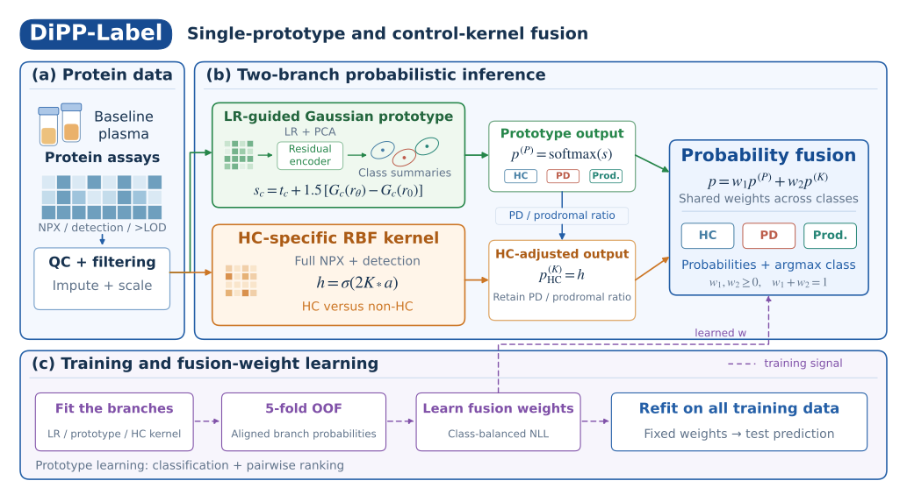

<h1 align="center">DiPP-Label：单原型与HC核融合的血浆蛋白三分类</h1>

<p align="center">
  <a href="README.md">English</a> ·
  <a href="docs/method.md">方法</a> ·
  <a href="docs/data.md">数据准备</a> ·
  <a href="docs/validation.md">发布核验</a> ·
  <a href="LICENSE">MIT许可证</a>
</p>

## 项目介绍

血浆蛋白组为区分健康对照（HC）、帕金森病（PD）和前驱期提供分子信息。DiPP-Label将三分类预测与蛋白贡献分析结合：单成员Gaussian原型围绕逻辑回归评分学习残差修正，HC核刻画对照类与其余类别的差异，再利用训练折外预测学习融合权重。分组SHAP分别解释PD—前驱期、HC—前驱期和HC—PD三条边界的蛋白贡献。论文在325名具有糖尿病相关证据的参与者、三套人员划分上报告平均Macro-F1 **0.5719**、Macro OvO AUC **0.7370**。本仓库提供最终模型、四组组件消融、常见分类器对照和完全合成的示例。**发布版统一使用CPU训练。**

<p align="center">
  
</p>

## 合成示例

[`dataset/example`](dataset/example)包含**216名虚构参与者和64个虚构蛋白检测项**，并包含缺失值、QC失败、同人跨项目记录和3条用于演示排除规则的记录。参与者、检测项名称与测量值均由固定随机种子生成，没有使用真实PPMI记录、真实模型参数或真实数据分布估计。

| 文件 | 用途 |
| --- | --- |
| [participants.csv](dataset/example/participants.csv) | 入组类别与人群筛选信息 |
| [assays.csv](dataset/example/assays.csv) | 蛋白检测项标识和名称 |
| [plasma.csv](dataset/example/plasma.csv) | NPX、LOD、项目、访视与QC字段 |
| [SYNTHETIC_DATA.json](dataset/example/SYNTHETIC_DATA.json) | 生成种子、用途与文件校验值 |

示例采用本代码的标准化PPMI风格接口，不冒充PPMI官方导出文件。合成数据成绩用于理解运行方式，论文成绩来自实际研究队列。

## 模型配置

| 组件 | 论文配置 | 代码 |
| --- | --- | --- |
| 蛋白特征 | NPX／检出／低检出项的超LOD幅度，训练折内拟合 | [features.py](src/dipp_label/features.py) |
| LR教师 | 类别平衡多项LR，C=0.003 | [numerics.py](src/dipp_label/numerics.py) |
| Gaussian原型 | 单成员16维残差编码器，编码器参数256个 | [model.py](src/dipp_label/model.py) |
| Episode训练 | 800步，每步4个episode，每类5支持＋5查询 | [paper.json](configs/paper.json) |
| HC核与融合 | RBF核、类别平衡、训练折外单纯形权重 | [model.py](src/dipp_label/model.py) |
| 蛋白解释 | 同assay分组SHAP，解释三条log概率比 | [analysis.py](src/dipp_label/analysis.py) |

`configs/paper.json`保留最终算法配置；`configs/example.json`降低训练、选参和SHAP预算，便于快速运行。仓库不附真实训练权重：HC核的拟合状态包含训练表示。示例在内存中自行完成训练。

## 使用方法

### 1. 准备数据

先使用仓库自带合成示例跑通流程。真实PPMI数据需自行按访问条件取得，再转换为[输入规范](docs/data.md)：

```text
dataset/
├── example/                 # 本仓库自带合成示例
│   ├── participants.csv
│   ├── assays.csv
│   ├── plasma.csv
│   └── SYNTHETIC_DATA.json
└── private/my_cohort/        # 自行取得的真实数据，Git忽略
    ├── participants.csv
    ├── assays.csv
    └── plasma.csv
```

数据处理选择基线血浆、屏蔽QC失败值、执行人群筛选；同一参与者优先使用合格的Project314样本，否则使用Project293。`DM_CORE_EVIDENCE`和`QC_Pass`是已核对的明确标志，不由程序猜测任意临床或QC文字代码。蛋白筛选、填补、标准化和PCA均在训练折内拟合。

### 2. 安装环境

使用**Python 3.10–3.12**和CPU版PyTorch：

```bash
git clone https://github.com/tianj5920-del/DiPP.git
cd DiPP
python -m venv .venv
source .venv/bin/activate
python -m pip install torch==2.7.1 --index-url https://download.pytorch.org/whl/cpu
python -m pip install -e '.[analysis,baselines,test]' -c constraints-cpu.txt
python -m pytest -q
```

已测试版本固定在[constraints-cpu.txt](constraints-cpu.txt)。SVM和树模型在独立CPU进程中执行，避免其计算库与PyTorch运行时冲突。CPU线程数在配置文件中设置。

```bash
dipp-label check-data --data dataset/example
dipp-label make-example --out dataset/example --overwrite
```

### 3. 训练

运行最终模型、LightGBM、LR及随机参照：

```bash
dipp-label run --data dataset/example --config configs/example.json \
  --out outputs/example --models dipp_label lightgbm lr random --shap
```

命令依次完成训练内部验证、全训练集拟合、留出集评估及可选SHAP分析。每轮使用新输出目录。切换为`configs/paper.json`即可采用论文训练配置。

| 消融名称 | 含义 |
| --- | --- |
| `without_hc` | 去掉HC核，保留LR指导原型 |
| `lr_hc` | 去掉原型修正，保留同源LR＋HC核 |
| `lr_free_hc` | 完全无LR原型＋HC核 |
| `lr_free` | 完全无LR原型单独使用 |

<details>
<summary>全部消融与常见分类器运行命令</summary>

```bash
dipp-label run --data dataset/example --config configs/example.json \
  --out outputs/ablations --models dipp_label without_hc lr_hc lr_free_hc lr_free

dipp-label run --data dataset/example --config configs/example.json \
  --out outputs/classifiers --models lr linear_svm rbf_svm random_forest extra_trees \
  lightgbm xgboost mlp residual_mlp random
```

分类器按训练内部折外OvO AUC选参，具体参数网格和神经网络结构见[baselines.py](src/dipp_label/baselines.py)。

</details>

### 4. 推理与评估

```python
from dipp_label.config import Config
from dipp_label.data import load_cohort
from dipp_label.model import DiPPLabel
from dipp_label.splits import holdout
from dipp_label.metrics import complete_metrics

data = load_cohort("dataset/example")
train, test = holdout(data, seed=71750)
model = DiPPLabel(Config.load("configs/example.json")).fit(data.take(train))
probabilities = model.predict_proba(data.take(test))
metrics = complete_metrics(data.y[test], probabilities)
# 概率列顺序始终是 HC、Prodromal、PD。
```

默认产生新的按类别分层随机划分。已有固定名单可通过`--splits allocations.csv`导入，列为`PATNO,seed,split`。仓库不含论文的私有人员名单，只有相同种子不能重建原人员分配。

| 输出 | 内容 |
| --- | --- |
| `run_manifest.json` | 配置、软件版本、类别顺序、人数与划分口径 |
| `metrics_by_split.csv` | 每组、每次、每个评估阶段的完整指标 |
| `summary.json` | 重复运行的均值和标准差 |
| `report.md` | 总体与逐类指标对比表 |

分别报告Macro OvO AUC、Macro OvR AUC、三条log概率比的两两AUC、准召、F1、准确率、AP、Brier与log-loss。命令行写出聚合指标，不输出逐人预测。

### 5. 蛋白分析

包含`dipp_label`的运行加`--shap`即可。每个检测项的全部通道组成一个SHAP组；背景来自训练集，两类等权，解释冻结模型的连续两两评分。

| 输出 | 内容 |
| --- | --- |
| `shap_all_rankings.csv` | PD—前驱期、HC—前驱期和HC—PD三张全榜 |
| `shap_top50.csv` | 各榜Top50、贡献值及以自身Top1为100的归一化占比 |
| `shap_checks.json` | 加总核验、受评／背景人数及跨模型排名一致性 |

重要性按受评两类等权、各模型等权的平均绝对SHAP排序。表达方向根据训练四分位点划定高低NPX区间，比较同类受评者的平均贡献。示例每类最多解释3人、运行2轮排列；论文配置解释全部测试参与者、运行16轮。详见[方法说明](docs/method.md)。

## 发布核验

CPU版已通过**24项测试**和覆盖**15个模型／参照**的端到端合成数据运行，共产生**30组验证／测试指标记录**。分组SHAP最大加总重建误差为**6.32e-07**，完整示范在测试环境中约需**345秒**。这些核验针对独立代码包及合成工作流，本轮未重新训练真实研究队列。详见[核验记录](docs/validation.md)和[来源登记](docs/provenance.json)。

## 许可证与引用

代码及合成示例采用[MIT许可证](LICENSE)。PPMI数据和第三方依赖仍适用各自的访问条件与许可证。软件引用信息见[CITATION.cff](CITATION.cff)。
